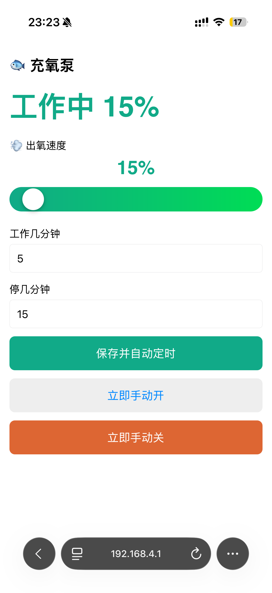
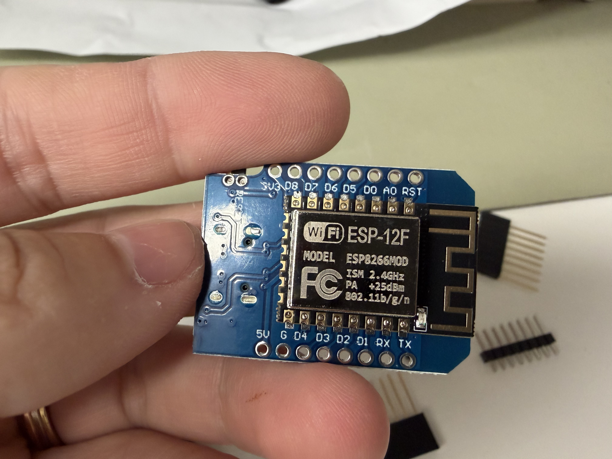
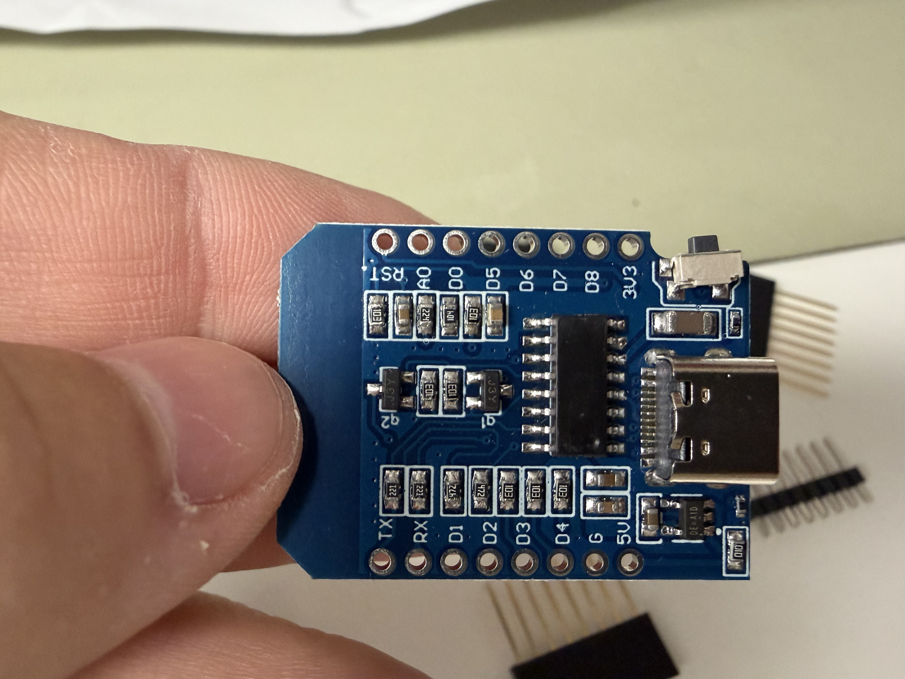
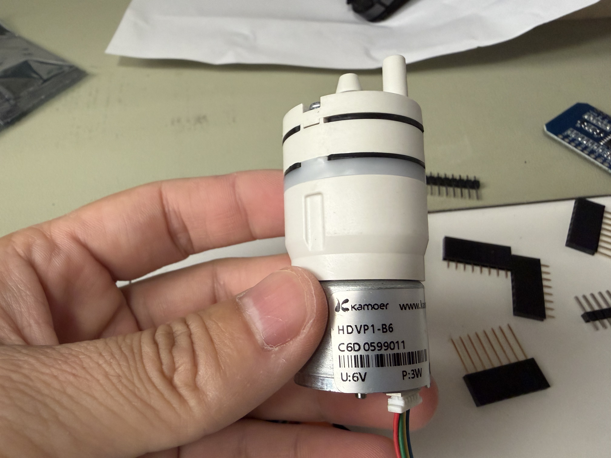
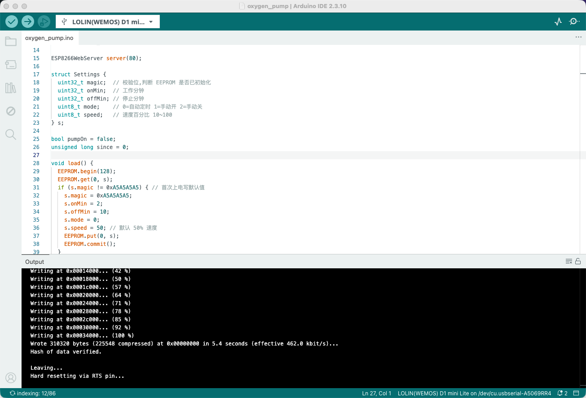

# 🐟 DIY 鱼缸充氧泵（ESP8266 + 无刷泵 · 手机 WiFi 控制 · PWM 调速）

一个用 ESP8266（Wemos D1 mini）+ Kamoer 无刷气泵做的智能鱼缸充氧泵。手机连 WiFi 即可控制开关、定时、调速，总成本不到 ¥100。

## ✨ 功能特点

- 📱 **手机浏览器控制** — 无需安装 App，连上 WiFi 热点打开网页即可
- ⏱️ **自定义间歇定时** — 设置工作 X 分钟、停 Y 分钟，自动循环
- 💨 **PWM 无级调速** — 10%~100% 滑块控制出氧量，小缸不怕翻江倒海
- 💾 **断电记忆** — 设置保存在 EEPROM，断电重启自动恢复
- 🔌 **USB 供电** — 5V 充电器或充电宝即可驱动

### 效果展示



---

## 一、物料清单（BOM）

只需要 **3 个核心模块** + 杜邦线：

| 件 | 型号/规格 | 参考价 | 说明 |
|----|----------|--------|------|
| 🧠 主控 | **Wemos D1 mini**（ESP8266, Type-C） | ¥10~15 | 自带 WiFi，当热点 + Web 服务器 |
| 💨 气泵 | **Kamoer HDVP1-B6**（6V/3W, 无刷, 5 线） | ¥30~50 | 内置驱动板，支持 PWM 调速 |
| 🔗 连线 | **杜邦线** 公对母 / 母对母若干 | ¥2~5 | 3 根就够 |

### 你还需要

| 件 | 说明 |
|----|------|
| 硅胶管 + 气石 | 鱼缸店几块钱一套 |
| 5V USB 电源（≥2A） | 手机充电器或充电宝 |
| USB Type-C **数据线** | 烧录代码用（不是纯充电线！） |
| 烙铁 + 焊锡 | 焊 D1 mini 排针（或买已焊好的版本） |

### 可选

| 件 | 说明 |
|----|------|
| 万用表 | 检测焊接质量、排查问题 |
| 气量调节阀 | 物理微调气量的十字小阀门，¥1~3 |
| 面包板 | 方便接线测试，不用焊接 |

> [!TIP]
> **不需要 MOS 模块和二极管！** Kamoer HDVP1-B6 内置无刷驱动板，D1 mini 的 GPIO 直接输出 PWM 信号到泵的蓝线即可控制，大幅简化了电路。

---

## 二、认识你的配件

### Wemos D1 mini（ESP8266）

| 正面 | 背面 |
|:----:|:----:|
|  |  |

- ESP-12F WiFi 芯片，2.4GHz 802.11b/g/n
- Type-C USB 接口（烧录 + 供电）
- 工作电压 3.3V，USB 口供 5V
- 11 个 GPIO，本项目只用 **D1** 一个引脚

### Kamoer HDVP1-B6 气泵



- 额定电压 6V，功率 3W（5V USB 可驱动，气量略小但够用）
- **5 根线**定义：

| 线色 | 功能 | 是否需要接 |
|------|------|:----------:|
| 🔴 红 | 电源 +（VCC） | ✅ 接 D1 mini 的 5V |
| ⚫ 黑 | 电源 -（GND） | ✅ 接 D1 mini 的 G |
| 🔵 蓝 | PWM 调速信号 | ✅ 接 D1 mini 的 D1 |
| 🟢 绿 | FG 转速反馈 | ❌ 悬空 |
| 🟡 黄 | 空置 | ❌ 悬空 |

---

## 三、接线图

只需要 **3 根杜邦线**，极简接法：

```
D1 mini                      HDVP1-B6 泵
┌──────────┐                ┌──────────┐
│          │                │          │
│    5V  ──┼────────────────┼── 红线    │  (电源+)
│          │                │          │
│     G  ──┼────────────────┼── 黑线    │  (GND)
│          │                │          │
│    D1  ──┼────────────────┼── 蓝线    │  (PWM 调速)
│          │                │          │
└──────────┘                │   绿线 ✂  │  (悬空)
                            │   黄线 ✂  │  (悬空)
                            └──────────┘
```

> [!IMPORTANT]
> - **绿线和黄线不要接！** 绿线是转速反馈信号，黄线是空置引脚，都不需要
> - 接线前**务必断电**（拔掉 USB）
> - 确认红线接 5V、黑线接 G（GND），**接反会烧板子**

---

## 四、烧录固件

### 第 1 步：安装开发环境

1. 下载安装 [Arduino IDE](https://www.arduino.cc/en/software)（macOS / Windows / Linux）
2. 打开 Arduino IDE → **设置（Preferences）**
3. 「附加开发板管理器网址」填入：
   ```
   http://arduino.esp8266.com/stable/package_esp8266com_index.json
   ```
4. **工具 → 开发板管理器** → 搜索 `esp8266` → 安装

### 第 2 步：连接与配置

1. D1 mini 排针焊好后（见下方「焊接指南」），用 Type-C **数据线** 连 Mac / PC
2. **工具 → 开发板** → 选 **LOLIN(WEMOS) D1 mini**
3. **工具 → 端口** → 选出现的串口（如 `/dev/cu.usbserial-xxxx`）

> [!WARNING]
> 端口里没有设备？检查：
> - USB 线是否是**数据线**（纯充电线没有数据芯）
> - 可能需要安装 [CH340 驱动](https://www.wch.cn/downloads/CH341SER_MAC_ZIP.html)

### 第 3 步：上传代码

1. **文件 → 打开** → 选择 `oxygen_pump/oxygen_pump.ino`
2. 点击 **→ 上传按钮**
3. 等待编译 + 写入完成



> [!NOTE]
> **烧录完全可逆！** ESP8266 的 Flash 支持 10,000+ 次擦写，随时可以刷新代码。软件层面不可能烧坏硬件，放心实验。

### 第 4 步：验证

串口监视器（波特率 115200）应打印 `192.168.4.1`，说明 WiFi 热点已启动。

---

## 五、使用方法

1. **接好线** → USB 供电启动 D1 mini
2. 手机 WiFi 搜索连接 **「OxygenPump」**，密码 `12345678`
3. 浏览器打开 **`http://192.168.4.1`**
4. 控制面板功能：

| 控件 | 功能 |
|------|------|
| 💨 出氧速度滑块 | 10%~100% 调节泵转速 |
| 工作几分钟 | 每个周期泵运转的时长 |
| 停几分钟 | 每个周期泵休息的时长 |
| **保存并自动定时** | 保存设置，开始间歇循环 |
| **立即手动开** | 立刻以当前速度启动泵 |
| **立即手动关** | 立刻停止泵 |

> [!TIP]
> **推荐设置（5L 小缸）**：速度 15~30%，工作 5 分钟，停 15 分钟。从低速开始调，气泡细密均匀即可。

---

## 六、焊接指南

D1 mini 出厂排针是散的，需要焊接后才能插杜邦线。

### 焊接步骤

1. 排针插入 D1 mini 两侧通孔
2. 烙铁温度 320~360°C，每个焊点 2~3 秒
3. 焊锡量适中——能包住焊盘和引脚即可

### 用万用表检查焊接质量

1. **断电！** 拔掉 USB
2. 万用表拨到 **蜂鸣器/通断档**（🔊）
3. 红笔碰排针顶部，黑笔碰背面焊锡点：
   - **响** ✅ = 焊接良好
   - **不响** ❌ = 虚焊，需要补焊
4. 测相邻两根引脚之间：
   - **不响** ✅ = 正常
   - **响** ❌ = 短路了，用烙铁清除多余焊锡

**重点检查这 3 个脚**：`5V`、`G`（GND）、`D1` — 接泵要用的。

---

## 七、代码说明

完整代码见 [`oxygen_pump/oxygen_pump.ino`](oxygen_pump/oxygen_pump.ino)。

### 架构

```
┌─────────────┐     WiFi AP      ┌──────────────┐
│  ESP8266    │  "OxygenPump"   │   手机浏览器   │
│  D1 mini    │◄───────────────►│ 192.168.4.1  │
│             │   HTTP GET      │              │
│  D1 引脚 PWM ├──────►蓝线──────►│  HDVP1-B6 泵 │
└─────────────┘                 └──────────────┘
```

### 关键实现

| 功能 | 实现方式 |
|------|---------|
| WiFi 热点 | `WiFi.softAP()` 创建 AP，无需路由器 |
| Web 控制 | `ESP8266WebServer` 提供网页 + REST API |
| PWM 调速 | `analogWrite()` + `analogWriteFreq(20000)` 输出 20kHz PWM |
| 间歇定时 | `millis()` 非阻塞计时，不影响 Web 响应 |
| 断电记忆 | `EEPROM` 保存设置（magic 校验防首次乱读） |
| 状态同步 | 前端 `setInterval` 每 2 秒轮询 `/state` 接口 |

### API

| 路径 | 方法 | 功能 |
|------|------|------|
| `/` | GET | 返回控制页面 HTML |
| `/state` | GET | 返回 JSON：`{"on":1,"speed":50}` |
| `/set` | GET | 设置参数：`?on=5&off=15&speed=30&mode=0` |

---

## 八、注意事项 / 避坑

### 电源相关

- **充电宝自动关断**：泵「停止」时总电流很低，充电宝可能判定无负载而断电。解决方案：
  - ① 用**手机充电器**（最稳）
  - ② 换带「常开模式」的充电宝
  - ③ 并联一个假负载（如 LED + 100Ω 电阻）
- **启动电流**：泵启动瞬间电流是额定 2~3 倍，电源选 **2A 以上**

### 泵相关

- **5V 驱动 6V 泵**：HDVP1-B6 额定 6V，用 5V USB 可以正常工作，只是气量略小。如果需要更大气量，可以用 6V 电源适配器
- **先单独测泵**：接线前先直接 5V 接红线和黑线（蓝线悬空 = 全速），确认泵能转、出气正常
- **最低转速**：PWM 低于某个值泵可能不转，正常现象，提高到能稳定运转的最低值即可

### 硬件保护

- ⚠️ **绝对不要接反正负极**（5V 和 GND 接反会烧板子）
- ⚠️ **不要往 GPIO 引脚灌入超过 3.3V 的电压**
- ✅ 蓝线是信号输入，电流极小（微安级），D1 引脚直接驱动完全安全

---

## 九、可扩展方向

| 方向 | 说明 |
|------|------|
| 🌐 接入家庭 WiFi | 改用 WiFiManager 库，连家里路由器，手机上网同时能控 |
| ☁️ 远程控制 | 接 MQTT / Blynk / Home Assistant，外网也能控 |
| 🌡️ 传感器联动 | 加水温 / 溶氧传感器，按需自动启停 |
| 📊 运行日志 | 记录每日运行时长、开关次数 |
| 🔋 太阳能供电 | 加太阳能板 + 锂电池，户外鱼缸也能用 |

---

## 📜 License

MIT — 随便用，开心就好 🐟
